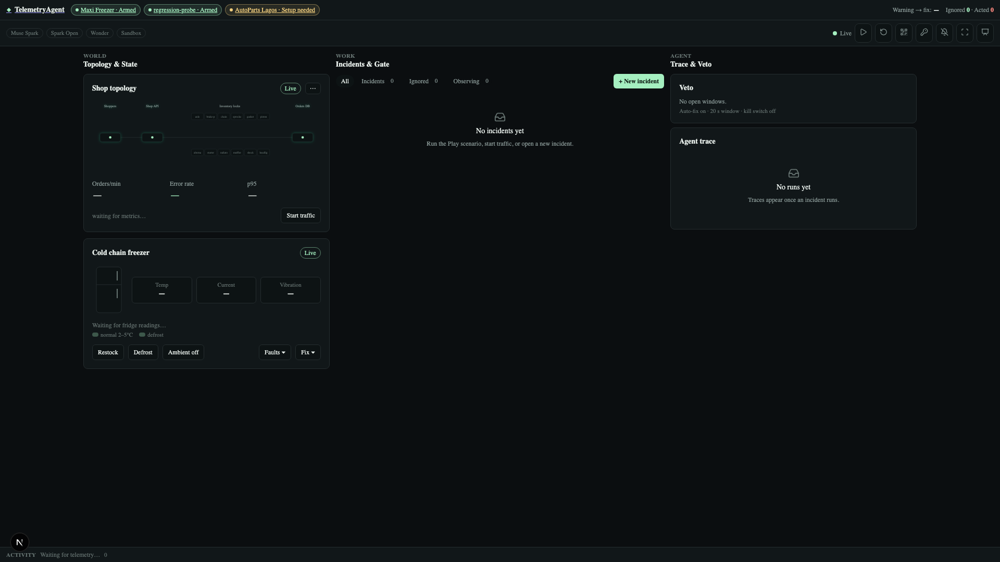
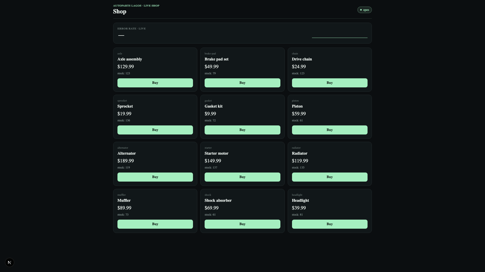
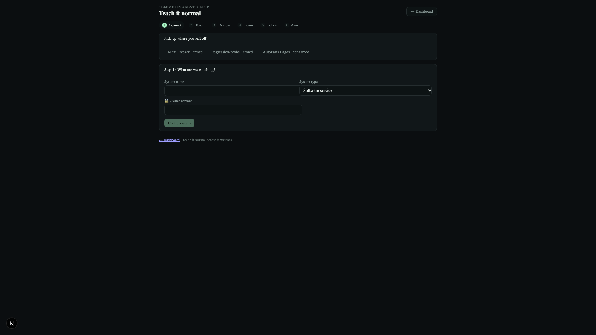

# TelemetryAgent

An autonomous SRE agent on Meta's Muse models that diagnoses crashes, writes
fixes with the open-weight **Muse Spark Open**, proves them in a **Modal
sandbox**, and opens the **PR** — and the same reasoning core diagnoses
physical equipment.

Built for the [Meta Global AI Developer Hackathon](https://cerebralvalley.ai/e/meta-ai-developer-hackathon/details)
(Indie Developer track, Push the Frontier). The repository was started fresh
for the event — every line was written during the hackathon (Oct 27 – Nov 4).

## Two doors, one agent

- 🟢 **Simulation route (the 3-minute demo):** advert-style landing → onboarding
  → guided setup of a demo shop + cold-chain freezer → a coach-marked first
  incident on Mission Control → wrap-up. Everything runs locally with our
  simulators; nothing external breaks the video.
- 🔵 **Production route (the real product):** connect your server (log forwarder
  or Sentry webhook), your GitHub repo, your hosting (Railway or a signed
  webhook) and cold-chain devices. TelemetryAgent catches a real error, proves
  a fix on **your code** in a sandbox, and opens a **PR on your repo** — while
  the phone rings with fix options. Nothing shuts down without a human (see
  [the uptime promise](#uptime-promise)). Auto-fix today: **Python**; rolling
  out: **JavaScript/TypeScript, Java, Kotlin, Go, Rust, PHP** (per-language
  repo needs: [docs/USAGE.md](docs/USAGE.md)).

## The 3-minute demo (judges start here)

```bash
# terminal 1: API (http://localhost:8001)
TA_DATA_DIR=$PWD/data venv/bin/python -m uvicorn apps.api.main:app --port 8001
# terminal 2: shop simulator (http://localhost:8002)
TA_DATA_DIR=$PWD/data venv/bin/python demo/shop/app.py
# terminal 3: dashboard (http://localhost:3000)
NEXT_PUBLIC_API_URL=http://localhost:8001 npm run dev --workspace apps/web
```

Then open the journey:

1. `http://localhost:3000/welcome` — the advert landing ("Try the live demo").
2. `/start` — onboarding cards; `/start/setup` — guided setup arms **both**
   demo systems at once (shop + freezer).
3. `/` — Mission Control with the first-incident tour: inject a deadlock,
   watch the gate decide, follow diagnose → patch → verify live, get the
   real PR, then the wrap-up.

What to look for: the **gate** cites its sources ("Expected: defrost, spec
sheet p.2"); the **proof** is fail-to-pass in an isolated sandbox, not vibes;
the **PR is real** (e.g. [#9](https://github.com/maximuskay2/telemetryAgent-demo/pull/9),
a one-line lock-order fix with repro test, suite 5 passed / 0 new failures);
every auto-action waits out a **20-second phone veto** first.

## Screenshots






## Interfaces

- **Web dashboard:** Mission Control at `/` — shop topology, freezer state,
  incident list with gate cards and detail drawer, agent trace and veto ring.
  Onboarding at `/welcome`, `/start`, `/start/setup`; the pre-redesign
  dashboard stays at `/classic`.
- **Setup wizard:** `/setup` — upload spec docs, review the extracted profile,
  learn a baseline, set policy, arm. Extraction quotes every value, flags
  conflicts instead of guessing, and never lets documents set policy or hard
  limits. After arming, every hit passes the gate: hard limits always act;
  expected behaviours, modes and the baseline suppress with citations;
  anything else needs proof of impact or stays a quiet observe.
- **Mobile app** (`apps/mobile/`, Flutter): veto countdown, full-screen alarm,
  run reports, activity feed, QR pairing, foreground service — and the
  production action center: "PR ready / Roll back now" and "Choose a fix"
  hardware cards plus a Pause-all toggle, all wired to the live API.
- **Simulators:** AutoParts Lagos shop (retries, deadlocks, load) and a
  cold-chain fridge/freezer (door, defrost, compressor) with injectable
  faults, plus a software ESP32 (`hardware/sim_device.py`) and Wokwi
  firmware that speak the production device protocol.

## Production route (how a real customer uses it)

`/welcome` → **Connect your production** → the `/connect` wizard: name the
system →
logs (one-liner forwarder with a `ta_live_*` key, Sentry webhook, or curl;
live "✓ first log") → repo + Test → hosting (Railway or signed webhook) +
test ping → device key + firmware snippet → teach normal → permissions +
uptime promise → pair phone → Start watching.

Behind it (all on `main`, `check.sh` green):

- **Ingest** (`core/ingest/`, `agent/ta_forward.py`): multi-line tracebacks
  become one candidate with parsed frames, even split across batches; the
  stdlib forwarder buffers through API outages.
- **Real fix pipeline** (`core/repo_fix/`): frames → repo files → tarball at
  the failing commit → Modal sandbox (Docker fallback; customer secrets never
  go inside) → baseline suite → repro test must FAIL → patch (≤ 3 files) →
  repro passes + zero new failures → PR with evidence, **one open PR per
  error fingerprint** (repeats comment instead). No tests / too big →
  draft PR with diagnosis only, never a crash.
- **Safe mitigations** (`core/actions/mitigate.py`): allowlist is `rollback`
  + `restart` **only** — stop/delete/scale-to-zero are impossible by
  construction. Railway adapter + HMAC-signed webhooks, 1 mitigation per
  system per 10 minutes, none while learning, everything audited.
- **Devices** (`core/devices/`, John's): hardware fix options from the run's
  runbook + profile (defrost, setpoint within limits, compressor
  power-cycle after the delay, backup unit, manual checklist, technician
  dispatch), fail-closed safety, 2-minute command queue with acks.

### Uptime promise

Read-only by default (logs come to us; no SSH, no DB credentials). Fixes
arrive as PRs — never direct edits. Only reversible actions run
automatically, every action waits out the 20 s cancel window and rings the
phone, and kill switches exist at every level (global, per-system Stop
watching, per-connection Disconnect, Pause-all). Secrets are server-side,
hashed/masked, never in `NEXT_PUBLIC_*`.

## Architecture

```text
   [ crash log / Sentry ]   [ appliance sensors ]   [ forwarder ta_forward.py ]
             └──────────────────────┬──────────────────────┘
                                    ▼
                    gate (profile + baseline + hard limits)
                        suppress / observe / act (cited)
                                    ▼
               muse-spark-1.3 (Meta Model API) — diagnose
                                    ▼
              meta-models/muse-spark-open on Baseten
              (backup: Fireworks → muse-spark-1.3)
                software → patch + pytest     appliance → runbook
                                    ▼
              software → pytest in Modal      appliance → safety rules
              (Docker fallback; repo runs: their code at the failing commit)
                                    │
                       FAIL ───────┴──────── PASS
                         ▼                        ▼
            retry with feedback (max 3,    software → GitHub PR
            last try muse-wonder-1.0)     appliance → alert + work order
                                          mitigations → rollback / restart
                                          (20 s phone veto, audit log)
```

Every step streams to the dashboard and the phone over WebSockets.

## Meta models and partners

| Role | Model | Provider |
| --- | --- | --- |
| Diagnosis and classification | `muse-spark-1.3` | Meta Model API |
| Patch, test and runbook generation | `meta-models/muse-spark-open` | Baseten |
| Generation backup | Muse Spark Open | Fireworks |
| Final-attempt escalation | `muse-wonder-1.0` | Meta Model API |
| Sandbox verification | — | Modal Sandboxes (Docker fallback) |
| Development | Muse Code | `muse` CLI |

## Run it

Requirements: Python 3.9+, Node.js 20.9+, npm, Docker (for local
verification), Flutter (for the mobile app).

```bash
python -m venv venv && venv/bin/pip install -r requirements.txt
cp .env.example .env   # then fill in the keys below
```

| Variable | Purpose |
| --- | --- |
| `MODEL_API_KEY` | Meta Model API (Muse Spark, Muse Wonder) |
| `BASETEN_API_KEY` | Muse Spark Open on Baseten |
| `MODAL_TOKEN_ID`, `MODAL_TOKEN_SECRET` | Modal Sandboxes (or `modal setup` once) |
| `TA_VERIFY=local` | Force local Docker verification instead of Modal |
| `GITHUB_TOKEN` | Opening pull requests (demo + connected repos) |
| `FIREWORKS_API_KEY`, `FIREWORKS_PATCH_MODEL` | Optional backup generation provider |
| `MOBILE_API_TOKEN` | `X-Mobile-Token` for phone approve/pause (empty = open, dev) |
| `PRODUCTION_CONNECT_ENABLED` | `0` hides the `/connect` door (default `1`) |
| `TA_FIXTURE_KEYS` | `1` accepts the `ta_live_fixture` key (tests only) |
| `RAILWAY_TOKEN` | Railway rollback/restart adapter |
| `TA_SANDBOX_IMAGE`, `DOCKER_BIN` | Docker verifier image / CLI path |

Credentials live in `.env` (git-ignored). Never commit keys, and do not
send sensitive log content to remote services.

Checks: `./scripts/check.sh` runs the Python suite, the simulation-route
smoke test (spins the API on a spare port, arms the demo shop, runs two
live agent runs), the web build, and `flutter analyze` + `flutter test`.
620+ Python tests, 56 Flutter tests, all externals mocked (GitHub, Railway,
Sentry, Modal) with live Docker + webhook coverage.

## Repository layout

```text
apps/api/          FastAPI hub: runs, sim, setup, gate, actions, WS (+ routes/production.py, routes/devices.py)
apps/web/app/      Next.js: Mission Control, welcome/start journey, setup, shop, /connect wizard
apps/mobile/       Flutter on-call app + action center
core/              schemas, infer, agent loop, verify (Modal/Docker/repo sandbox), actions, watch, setup, simulate
core/connections/  production connections + ta_live_* keys + GitHub checks
core/ingest/       traceback parsing, log/Sentry pipeline
core/repo_fix/     locate → snapshot → sandbox → repro → patch → prove → PR
core/devices/      hardware options + command queue (John)
agent/             ta_forward.py stdlib log forwarder (served at /forwarder.py)
demo/              shop + freezer simulators, samples, scenario, guided-setup profiles
hardware/          sim_device.py software ESP32 + Wokwi firmware (John)
examples/proof-app/ cart service with a real bug: 20 tests, Procfile, trigger script
scripts/           check.sh, smoke_demo.sh, build-sandbox-image.sh
tests/             unit + acceptance (test_prod_*, test_devices_*)
docs/              PRD, DOCUMENTATION, production-backend, proof-run
```

## Roadmap index

- [`docs/USAGE.md`](./docs/USAGE.md) — use it locally, run it in production,
  connect your production (the customer guide).
- [`roadmap.md`](./roadmap.md) — master plan + submission quick-sheet.
- [`about.md`](./about.md) — technical blueprint.
- [`production-roadmap.md`](./production-roadmap.md) — real integrations
  (🔵 route), the uptime promise, and the James/John build split.
- [`journey-roadmap.md`](./journey-roadmap.md) — the visitor golden path
  (advert → onboarding → first fixed incident).
- [`ui-roadmap.md`](./ui-roadmap.md), [`mobile-roadmap.md`](./mobile-roadmap.md),
  [`setup-roadmap.md`](./setup-roadmap.md),
  [`simulation-roadmap.md`](./simulation-roadmap.md) — look, app, setup, sims.

## Status

- ✅ Simulation route end to end (landing → setup → tour → wrap-up).
- ✅ Setup profiles, gate, baseline learning, feedback, veto windows.
- ✅ Shop + freezer simulators, Flutter app (veto, alarms, reports, feed,
  action center).
- ✅ Production backend: connections, ingest, repo-fix PRs (proven live:
  [telemetryAgent-demo#9](https://github.com/maximuskay2/telemetryAgent-demo/pull/9)),
  mitigations, pause, `/connect` wizard, devices + firmware.
- 🚧 Human-side leftovers: push `examples/proof-app/` to its own repo and
  deploy on Railway; compile-check the Wokwi sketch; joint proof run ×2,
  then the video. (FCM push was descoped: no Firebase project in the
  event window — the app uses live WebSocket alerts + foreground service.)

## License

MIT; see [LICENSE](./LICENSE).
