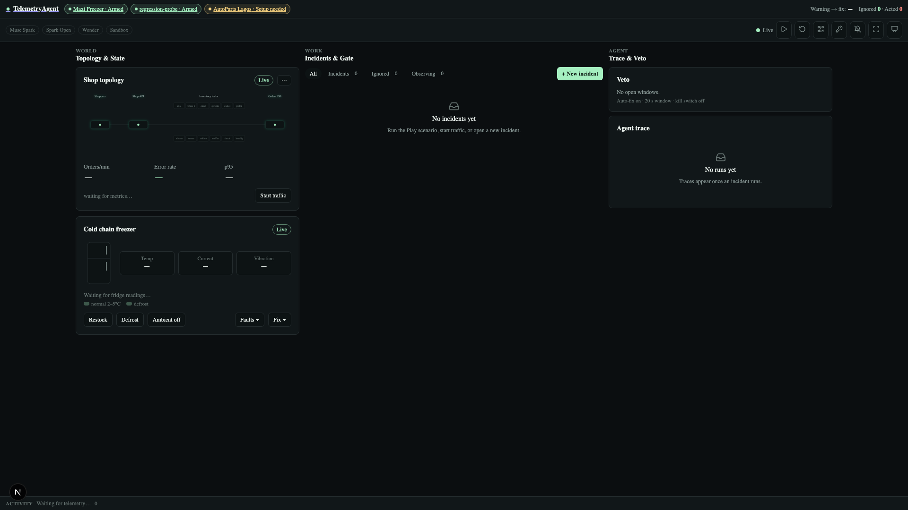
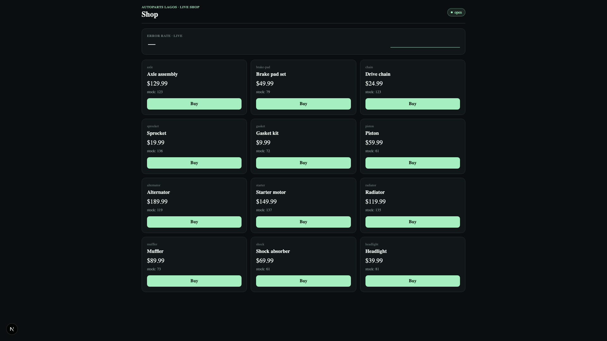
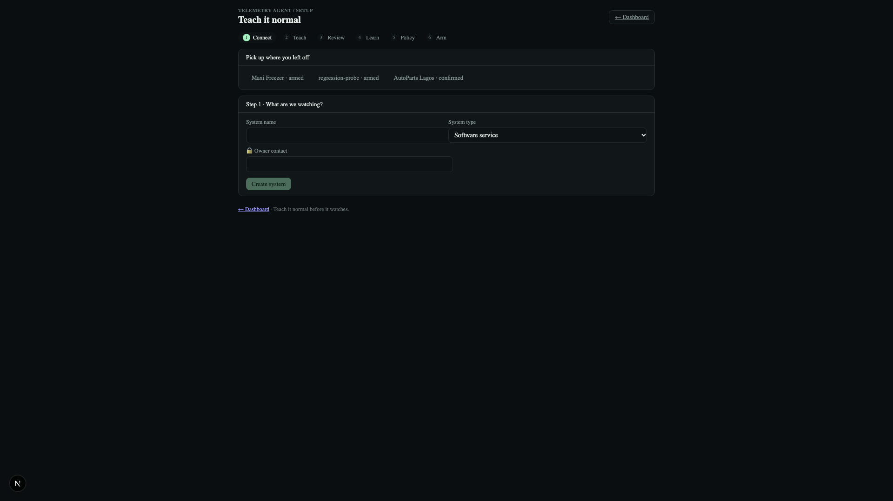

# TelemetryAgent


An autonomous SRE agent on Meta's Muse models that diagnoses crashes, writes
fixes with the open-weight **Muse Spark Open**, proves them in a **Modal
sandbox**, and opens the **PR** — and the same reasoning core diagnoses
physical equipment.

Built for the [Meta Global AI Developer Hackathon](https://cerebralvalley.ai/e/meta-ai-developer-hackathon/details)
(Indie Developer track, Push the Frontier). The repository was started fresh
for the event — every line was written during the hackathon (Oct 27 – Nov 4).

## Live

- **Demo:** [web-production-926b3.up.railway.app/welcome](https://web-production-926b3.up.railway.app/welcome) — Try the live demo. No account.
- **API:** [api-production-0c9a.up.railway.app](https://api-production-0c9a.up.railway.app)
- **How to use it:** [docs/USAGE.md](./docs/USAGE.md) · **Reference:** [docs/DOCUMENTATION.md](./docs/DOCUMENTATION.md)

## Built

What is in this repository today:

- **3-minute demo.** `/welcome` → `/start` → `/start/setup` arms the shop and the freezer together → Mission Control tour → wrap-up. The gate cites its source ("Expected: defrost, spec sheet p.2").
- **Two simulators.** AutoParts Lagos (retries, deadlocks, load) and a cold-chain freezer (door, defrost, compressor) with injectable faults.
- **Teach-it-normal.** `/setup` quotes every extracted value, flags conflicts, and never lets a document set policy. After arming, hard limits act, expected behaviour is ignored with a citation, and the rest stays a quiet observe until there is proof of impact.
- **Proven software repair.** Crash log → Muse Spark diagnosis → Muse Spark Open patch and pytest → fail-to-pass in a Modal sandbox (Docker fallback) → GitHub PR. Live proof: [telemetryAgent-demo#9](https://github.com/maximuskay2/telemetryAgent-demo/pull/9) (lock-order fix, suite 5 passed / 0 new failures). One open PR per error fingerprint; repeats comment. No tests or too big → draft PR with the diagnosis, never a crash.
- **Uptime promise.** Read-only by default. Fixes are PRs, not pushes. The only automatic hosting actions are `rollback` and `restart`. Each one waits out a **20-second phone veto**. Pause-all, per-system Stop watching, and per-connection Disconnect are kill switches. At most one mitigation per system per 10 minutes.
- **Connect a real system.** `/connect`: log forwarder (`ta_live_*` key) or Sentry, GitHub repo check, Railway or a signed webhook, device key, teach normal, pair the phone, then Start watching.
- **Phone** (`apps/mobile/`, Flutter): full-screen alarm, veto countdown, run reports, QR pairing, foreground service, plus "PR ready / Roll back now" and "Choose a fix" cards.
- **Equipment protocol.** `hardware/sim_device.py` posts readings and acks commands against the API (this is what the tests run). `hardware/wokwi/` is the same firmware as an ESP32 sketch plus circuit for [wokwi.com](https://wokwi.com) — paste it there and press play; that click-through is still a manual step.
- **Checks.** `./scripts/check.sh`: 1134 Python tests, the simulation-route smoke test, the web build + 147 web tests, and `flutter analyze` + 101 Flutter tests. GitHub, Railway, Sentry, and Modal are mocked; Docker and webhooks have live coverage.
- **Signed-in hub.** `/dashboard`: provisioned systems, unified setup drafts (guided + manual resume where they stopped), recent runs, and every destination. Mission Control opens once a system is armed; signed-in users see only their own systems, never the demo tiles. `/keys` lists every secret by `****last4` hint and rotates minted keys.

Hosted accounts, members, devices, and usage shipped (Clerk session, org isolation); billing is still specified, not shipped: [commercial-roadmap.md](./commercial-roadmap.md). Auto-fix ships for Python, JavaScript/TypeScript, Java, Kotlin, Go, Rust, and PHP ([languages-roadmap.md](./languages-roadmap.md) is the design record).

## Two doors, one agent

- 🟢 **Simulation route (the 3-minute demo):** advert-style landing → onboarding
  → guided setup of a demo shop + cold-chain freezer → a coach-marked first
  incident on Mission Control → wrap-up. Everything runs locally with our
  simulators; nothing external breaks the video.
- 🔵 **Production route (the real product):** connect your server (log forwarder
  or Sentry webhook), your GitHub repo, your hosting (Railway or a signed
  webhook) and cold-chain devices. TelemetryAgent catches a real error, proves
  a fix on **your code** in a sandbox, and opens a **PR on your repo** — while
  the phone rings with fix options. Nothing shuts down without a human (see
  [the uptime promise](#uptime-promise)). Auto-fix today: **Python,
  JavaScript/TypeScript, Java, Kotlin, Go, Rust, PHP** (per-language
  repo needs: [docs/USAGE.md](docs/USAGE.md)).

## The 3-minute demo (judges start here)

```bash
# terminal 1: API (http://localhost:8001)
TA_DATA_DIR=$PWD/data venv/bin/python -m uvicorn apps.api.main:app --port 8001
# terminal 2: shop simulator (http://localhost:8002)
TA_DATA_DIR=$PWD/data venv/bin/python demo/shop/app.py
# terminal 3: dashboard (http://localhost:3000)
NEXT_PUBLIC_API_URL=http://localhost:8001 npm run dev --workspace apps/web
```

Then open the journey:

1. `http://localhost:3000/welcome` — the advert landing ("Try the live demo").
2. `/start` — onboarding cards; `/start/setup` — guided setup arms **both**
   demo systems at once (shop + freezer).
3. `/` — Mission Control with the first-incident tour: inject a deadlock,
   watch the gate decide, follow diagnose → patch → verify live, get the
   real PR, then the wrap-up.

What to look for: the **gate** cites its sources ("Expected: defrost, spec
sheet p.2"); the **proof** is fail-to-pass in an isolated sandbox, not vibes;
the **PR is real** (e.g. [#9](https://github.com/maximuskay2/telemetryAgent-demo/pull/9),
a one-line lock-order fix with repro test, suite 5 passed / 0 new failures);
every auto-action waits out a **20-second phone veto** first.

## Screenshots






## Interfaces

- **Web dashboard:** Mission Control at `/` — topology, incident list with
  gate cards and detail drawer, agent trace and veto ring. Signed-in users
  see only their provisioned systems; Mission Control opens once a system
  is armed, with draft selection before it until then. Onboarding at
  `/welcome`, `/start`, `/start/setup`; the signed-in hub at `/dashboard`
  (systems, drafts, runs, keys); the pre-redesign dashboard stays at
  `/classic`.
- **Setup wizard:** `/setup` — upload spec docs, review the extracted profile,
  learn a baseline, set policy, arm. Extraction quotes every value, flags
  conflicts instead of guessing, and never lets documents set policy or hard
  limits. After arming, every hit passes the gate: hard limits always act;
  expected behaviours, modes and the baseline suppress with citations;
  anything else needs proof of impact or stays a quiet observe.
- **Phone app** (`apps/mobile/`, Flutter): the on-call alarm and the
  production actions. How to run it is [below](#phone-app).
- **Simulators:** AutoParts Lagos shop (retries, deadlocks, load) and a
  cold-chain fridge/freezer (door, defrost, compressor) with injectable
  faults, plus a software ESP32 (`hardware/sim_device.py`) and Wokwi
  firmware that speak the production device protocol.

## Phone app

Flutter app in `apps/mobile/`. It is the thing that rings when the agent is about to act.

- **Alarm.** Full-screen countdown (the same 20 seconds as the dashboard), over the lock screen. **Disapprove** or **Approve now**, one tap. Sound and vibration step up in the last 5 seconds.
- **Reports.** Live feed and each incident: diagnosis, the proven fix, the decision, charts for the freezer, and the PR link.
- **Production.** "PR ready / Roll back now" for software, "Choose a fix" for the fridge, and Pause-all.

```bash
cd apps/mobile && flutter pub get && flutter run
```

The phone and the API have to be on the same Wi-Fi. Start the API with `--host 0.0.0.0`. In the app, connect by scanning the dashboard QR, claiming a pairing code from the web's Devices page, pasting a device token, or tapping Try the demo for a no-account demo session. On the Android emulator the API is `http://10.0.2.2:8001`. On a hosted API (Railway), set `API_PUBLIC_URL` to the public API domain so the QR carries a reachable URL. Settings → Test alarm plays a fake 20-second window without calling the server. A release APK is served from the web app at `/downloads/telemetry-agent.apk` (QR on `/start/phone`).

## Production route (how a real customer uses it)

`/welcome` → **Connect your production** → sign in → `/dashboard` → the
`/connect` wizard: System → Logs (one-liner forwarder with a `ta_live_*`
key, Sentry webhook, or curl; live "✓ first log") → Repo + Test → Teach
(upload a manual for auto-extract, or type limits by hand) → Hosting
(webhook-first guide, skippable) → Promise (uptime pledge) → Pair phone
(QR, pairing code, or no-account demo) → Start watching. Unfinished
setups wait as resumable drafts — `/connect` shows them first, and
manual `/setup` runs resume at their exact step.

Behind it (all on `main`, `check.sh` green):

- **Ingest** (`core/ingest/`, `agent/ta_forward.py`): multi-line tracebacks
  become one candidate with parsed frames, even split across batches; the
  stdlib forwarder buffers through API outages.
- **Real fix pipeline** (`core/repo_fix/`): frames → repo files → tarball at
  the failing commit → Modal sandbox (Docker fallback; customer secrets never
  go inside) → baseline suite → repro test must FAIL → patch (≤ 3 files) →
  repro passes + zero new failures → PR with evidence, **one open PR per
  error fingerprint** (repeats comment instead). No tests / too big →
  draft PR with diagnosis only, never a crash.
- **Safe mitigations** (`core/actions/mitigate.py`): allowlist is `rollback`
  + `restart` **only** — stop/delete/scale-to-zero are impossible by
  construction. Railway adapter + HMAC-signed webhooks, 1 mitigation per
  system per 10 minutes, none while learning, everything audited.
- **Devices** (`core/devices/`, John's): hardware fix options from the run's
  runbook + profile (defrost, setpoint within limits, compressor
  power-cycle after the delay, backup unit, manual checklist, technician
  dispatch), fail-closed safety, 2-minute command queue with acks.

### Uptime promise

Read-only by default (logs come to us; no SSH, no DB credentials). Fixes
arrive as PRs — never direct edits. Only reversible actions run
automatically, every action waits out the 20 s cancel window and rings the
phone, and kill switches exist at every level (global, per-system Stop
watching, per-connection Disconnect, Pause-all). Secrets are server-side,
hashed/masked, never in `NEXT_PUBLIC_*`.

## Architecture

```text
   [ crash log / Sentry ]   [ appliance sensors ]   [ forwarder ta_forward.py ]
             └──────────────────────┬──────────────────────┘
                                    ▼
                    gate (profile + baseline + hard limits)
                        suppress / observe / act (cited)
                                    ▼
               muse-spark-1.3 (Meta Model API) — diagnose
                                    ▼
              meta-models/muse-spark-open-1026 on Baseten
              (backup: Fireworks → muse-spark-1.3)
                software → patch + pytest     appliance → runbook
                                    ▼
              software → pytest in Modal      appliance → safety rules
              (Docker fallback; repo runs: their code at the failing commit)
                                    │
                       FAIL ───────┴──────── PASS
                         ▼                        ▼
            retry with feedback (max 3,    software → GitHub PR
            last try muse-wonder-1.0)     appliance → alert + work order
                                          mitigations → rollback / restart
                                          (20 s phone veto, audit log)
```

Every step streams to the dashboard and the phone over WebSockets.

## Meta models and partners

| Role | Model | Provider |
| --- | --- | --- |
| Diagnosis and classification | `muse-spark-1.3` | Meta Model API |
| Patch, test and runbook generation | `meta-models/muse-spark-open-1026` | Baseten |
| Generation backup | Muse Spark Open | Fireworks |
| Final-attempt escalation | `muse-wonder-1.0` | Meta Model API |
| Sandbox verification | — | Modal Sandboxes (Docker fallback) |
| Development | Muse Code | `muse` CLI |

## Run it

Requirements: Python 3.9+, Node.js 20.9+, npm, Docker (for local
verification), Flutter (for the mobile app).

```bash
python -m venv venv && venv/bin/pip install -r requirements.txt
cp .env.example .env   # then fill in the keys below
```

| Variable | Purpose |
| --- | --- |
| `MODEL_API_KEY` | Meta Model API (Muse Spark, Muse Wonder) |
| `BASETEN_API_KEY` | Muse Spark Open on Baseten |
| `MODAL_TOKEN_ID`, `MODAL_TOKEN_SECRET` | Modal Sandboxes (or `modal setup` once) |
| `TA_VERIFY=local` | Force local Docker verification instead of Modal |
| `GITHUB_TOKEN` | Opening pull requests (demo + connected repos) |
| `FIREWORKS_API_KEY`, `FIREWORKS_PATCH_MODEL` | Optional backup generation provider |
| `MOBILE_API_TOKEN` | `X-Mobile-Token` for phone approve/pause (empty = open, dev) |
| `DATABASE_URL` | Postgres for hosted accounts/systems (unset = file store, self-hosted) |
| `NEXT_PUBLIC_CLERK_PUBLISHABLE_KEY`, `CLERK_SECRET_KEY` | Clerk accounts (unset = mock/test session) |
| `NEXT_PUBLIC_API_URL` | API origin the web app calls |
| `PRODUCTION_CONNECT_ENABLED` | `0` hides the `/connect` door (default `1`) |
| `TA_FIXTURE_KEYS` | `1` accepts the `ta_live_fixture` key (tests only) |
| `RAILWAY_TOKEN` | Railway rollback/restart adapter |
| `TA_SANDBOX_IMAGE`, `DOCKER_BIN` | Docker verifier image / CLI path |

Credentials live in `.env` (git-ignored). Never commit keys, and do not
send sensitive log content to remote services.

Checks: `./scripts/check.sh` runs the Python suite, the simulation-route
smoke test (spins the API on a spare port, arms the demo shop, runs two
live agent runs), the web build + web tests, and `flutter analyze` +
`flutter test`. 1134 Python tests, 147 web tests, 101 Flutter tests, all
externals mocked (GitHub, Railway, Sentry, Modal) with live Docker +
webhook coverage.

## Repository layout

```text
apps/api/          FastAPI hub: runs, sim, setup, gate, actions, WS (+ routes/production.py, routes/devices.py)
apps/web/app/      Next.js: Mission Control, welcome/start journey, setup, /connect wizard, /dashboard hub, /keys
apps/mobile/       Flutter on-call app + action center
core/              schemas, infer, agent loop, verify (Modal/Docker/repo sandbox), actions, watch, setup, simulate
core/connections/  production connections + ta_live_* keys + GitHub checks
core/ingest/       traceback parsing, log/Sentry pipeline
core/repo_fix/     locate → snapshot → sandbox → repro → patch → prove → PR
core/devices/      hardware options + command queue (John)
agent/             ta_forward.py stdlib log forwarder (served at /forwarder.py)
demo/              shop + freezer simulators, samples, scenario, guided-setup profiles
hardware/          sim_device.py software ESP32 + Wokwi firmware (John)
examples/proof-app/ cart service with a real bug: 20 tests, Procfile, trigger script
scripts/           check.sh, smoke_demo.sh, build-sandbox-image.sh
tests/             unit + acceptance (test_prod_*, test_devices_*)
docs/              PRD, DOCUMENTATION, production-backend, proof-run
```

## Roadmap index

- [`docs/USAGE.md`](./docs/USAGE.md) — use it locally, run it in production,
  connect your production (the customer guide).
- [`roadmap.md`](./roadmap.md) — master plan + submission quick-sheet.
- [`about.md`](./about.md) — technical blueprint.
- [`production-roadmap.md`](./production-roadmap.md) — real integrations
  (🔵 route), the uptime promise, and the James/John build split.
- [`journey-roadmap.md`](./journey-roadmap.md) — the visitor golden path
  (advert → onboarding → first fixed incident).
- [`ui-roadmap.md`](./ui-roadmap.md), [`mobile-roadmap.md`](./mobile-roadmap.md),
  [`setup-roadmap.md`](./setup-roadmap.md),
  [`simulation-roadmap.md`](./simulation-roadmap.md) — look, app, setup, sims.
- [`commercial-roadmap.md`](./commercial-roadmap.md) — accounts, isolation,
  usage, and billing. Light mode is the default; dark stays. Meta product look.
- [`languages-roadmap.md`](./languages-roadmap.md) — the design record
  behind the shipped multi-language auto-fix (JS/TS, Java, Kotlin, Go,
  Rust, PHP alongside Python).

## Status

- ✅ Simulation route end to end (landing → setup → tour → wrap-up).
- ✅ Setup profiles, gate, baseline learning, feedback, veto windows.
- ✅ Shop + freezer simulators, Flutter app (veto, alarms, reports, feed,
  action center).
- ✅ Production backend: connections, ingest, repo-fix PRs (proven live:
  [telemetryAgent-demo#9](https://github.com/maximuskay2/telemetryAgent-demo/pull/9)),
  mitigations, pause, `/connect` wizard, devices, software ESP32.
- ✅ Public demo on Railway (welcome URL above).
- ✅ Multi-language auto-fix: Python, JS/TS, Java/Kotlin, Go, Rust, PHP
  (adapters in `core/repo_fix/lang/`, per-language `test_lang_*` suites).
- 🚧 Still manual: compile `hardware/wokwi/` on [wokwi.com](https://wokwi.com)
  and hold the door button; push `examples/proof-app/` to its own repo;
  joint proof run ×2; record the 3-minute video ([script](./docs/demo-video-script.md)).
  FCM push was descoped (no Firebase project in the event window — the
  app uses live WebSocket alerts + a foreground service).
- 📋 Specified, not in this tree yet: billing
  ([commercial-roadmap.md](./commercial-roadmap.md)).

## Contributors

Built by **Akingbade Kayode** (Maximusinfotech Services), the only human
on the project. James, John, Jude and Janet are **not people**: they are
Muse Code AI agents, each launched in its own terminal with its own role,
branch, and status file in [`status/`](./status/). Akingbade assigned the
work, reviewed it, and merged it to `main`.

| Agent (Muse Code) | Area |
| :--- | :--- |
| James | Backend core — commerce store, auth, language contracts, Java/Kotlin/Go |
| John | Web / app / look — Clerk session, members, devices, Meta-style UI |
| Jude | Usage + free allowance, Rust/PHP adapters, pulse-to-check logo |
| Janet | Tester — in-repo reports ([`status/test-janet.md`](./status/test-janet.md)) |

## License

MIT; see [LICENSE](./LICENSE).
